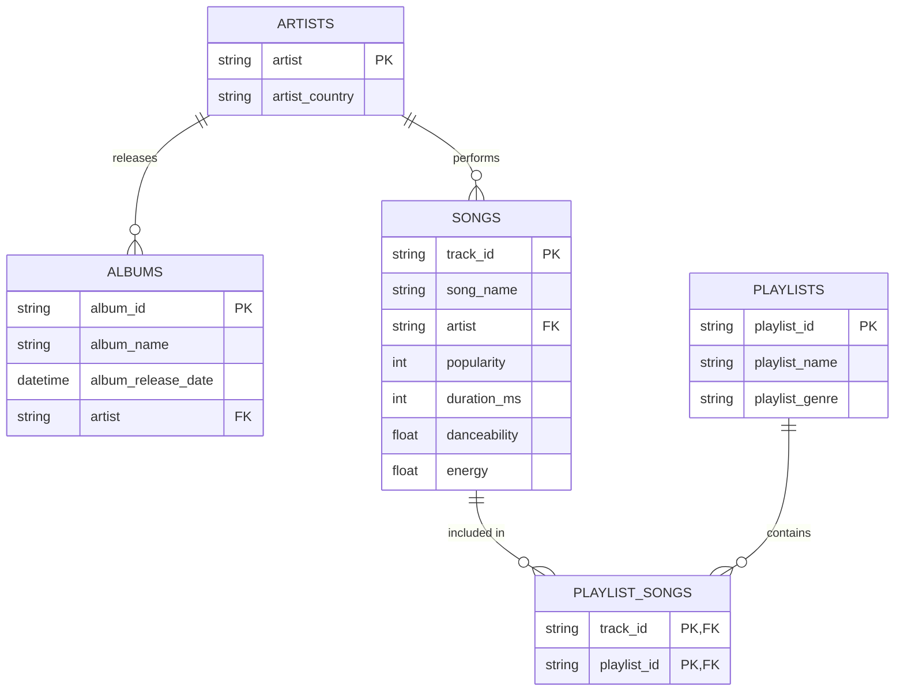

**Before you start:** rename this file to `unit3e_Music_lastname.md`, using your own last name. Read `unit3e_Walkthrough.md` and `unit3e_Music_Client.md` first. Commit and push this file **and** your Excel file when you're done.

**Name:**

**Partner(s):**

---

# Unit 3e — Design a Database for a Client: Music Streaming App

Both partners turn in the same design.

**Something we disagreed on, and how we settled it:**


**Our Excel file name (commit it to your repo next to this file, like `unit3e_Music_garcia.xlsx`):**


## 1. The client's spreadsheet

Look at the `Client_Export` tab.

**a.** Which column breaks 1NF? Which 1NF rule does it break?

**Answer:** Multiple values on one record


**b.** Find Ariana Grande's album *Sweetener*. How many rows repeat its release date? If the date were wrong, what would you have to do? What is that problem called?

**Answer:** ~12. It repeats it that number of times. It is an update anomaly if you were to change it.


**c.** Can `song_name` be the primary key of a songs table? Give an example from the data that shows why not. What should the key be instead?

**Answer:** No, as multiple songs can have the same name. They key should be a surrogate key of the dataset's creator's choice, preferrably a string of numbers and characters.


## 2. First normal form

Look at the `1NF` tab. Each row is one song on one playlist.

**d.** What is the primary key of the 1NF table? Why does it take more than one column?

**Answer:** The track_id. Some songs are repeated in playlists.


## 3. Second normal form — the whole key

For each column, check what it depends on: the song, the playlist, or both. Use your 1NF key from **d**.

| Column | Depends on the song? | Depends on the playlist? | Needs the whole key? |
|---|:-:|:-:|:-:|
| `popularity` | y | n | y |
| `album_name` | n | n | n |
| `playlist_name` | n | y | n |
| `playlist_genre` | n | y | n |

**e.** What is it called when a column depends on only part of the key? Which tables did you move those columns into?

**Answer:** Partial dependency. You move it into where it adheres to third normal form, or what it exclusively depends on.


**f.** After you split out songs and playlists, what columns are left in PLAYLIST_SONGS? Why so few?

**Answer:** Just two, being the keys of the song id, and the playlist id. They are both the only things required, as any other data can be fetched through either key.


## 4. Third normal form — nothing but the key

**g.** `album_release_date` is in every song row, but it isn't really a fact about the song. What does it depend on? What is that problem called?

**Answer:** It only depends on the album. It is a violation of second normal form.


**h.** `artist_country` has the same problem. What does it depend on?

**Answer:** Only the artist.


## 5. The client's mistakes

When you used Remove duplicates, two tables had one row too many. Find both mistakes.

| Table | What was wrong | What we kept |
|---|---|---|
| Artists | Ed Sheeran was entered as both United Kingdom and UK | Removed the one with United Kingdom |
| Albums | Sweetner had an incorrect date | Kept one date instead |

**i.** Why would these mistakes be impossible in your finished design?

**Answer:** One song/artist can only be connected to one id, one set of records.


## 6. Our tables

For each table, list every column and mark keys as `(PK)`, `(FK)`, or `(PK, FK)`. Give the number of rows your table has in the Sheet.

| Table | Columns | Rows |
|---|---|:-:|
| ARTISTS | artist (pk), artist_country | 20 |
| ALBUMS | album_id (pk), album_name, album_release_date, artist (fk) | 98 |
| SONGS | song_name (pk), artist (fk), popularity, duration_ms, danceability, energy |159 |
| PLAYLISTS | playlist_id (pk), playlist_name, playlist_genre | 8 |
| PLAYLIST_SONGS | track_id (pk) playlist_id (fk) | 159 |

**j.** Fill in the relationships. **Choose from:** one-to-one · one-to-many · many-to-many

| Relationship | Type | Where is the foreign key? |
|---|---|---|
| ARTISTS → SONGS | one-to-many | artists |
| ALBUMS → SONGS | one-to-many | songs |
| SONGS ↔ PLAYLISTS | many-to-many | track_id |

**k.** Which table is the junction table? What is its primary key?

**Answer:** the playlist_songs playlist. Track id.


## 7. ER diagram (AI writes the code)

Give your tables to AI and have it write the Mermaid code. Proof it and test it on mermaid.live. Then paste it here.



**Paste the prompt you gave the AI:** 

```text
Create a mermaid diagram (code) that gives an accurate diagram for this relational database, and how it is structured, including one-to-one or many-to-many relations. 
```

**l.** What did you have to fix in the AI's diagram? If nothing, what did you check?

**Answer:** I made sure all of the connections were accurate, and that each record was included correctly, within the correct table.


## 8. Check your design

- [ ] Every table has a primary key
- [ ] Every many-to-many goes through a junction table
- [ ] No cell holds a list
- [ ] No fact is stored in two places
- [ ] Every foreign key points at a primary key in another one of our tables

**Which normal form does your design reach, and how do you know?**

**Answer:** Third normal form. A record always relates to the primary key, and isn't required by a foreign key.


## Swap

Trade with a **different** pair. Run their design through the checklist in Part 8. Write one specific thing you'd change about theirs.

**Their names:**

**Feedback for the other pair:**
